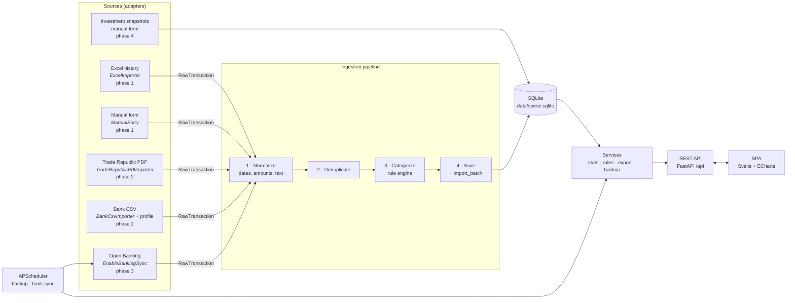
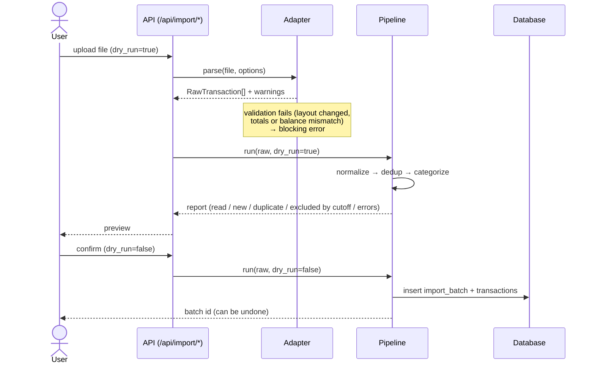
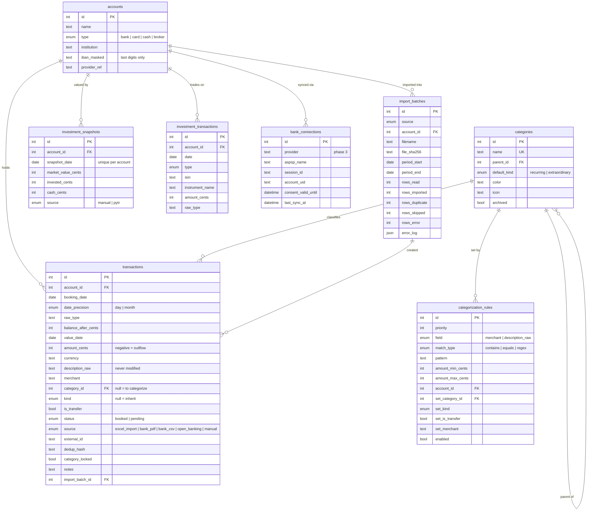
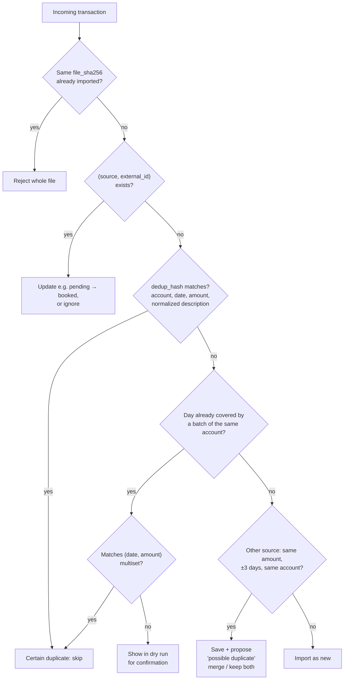
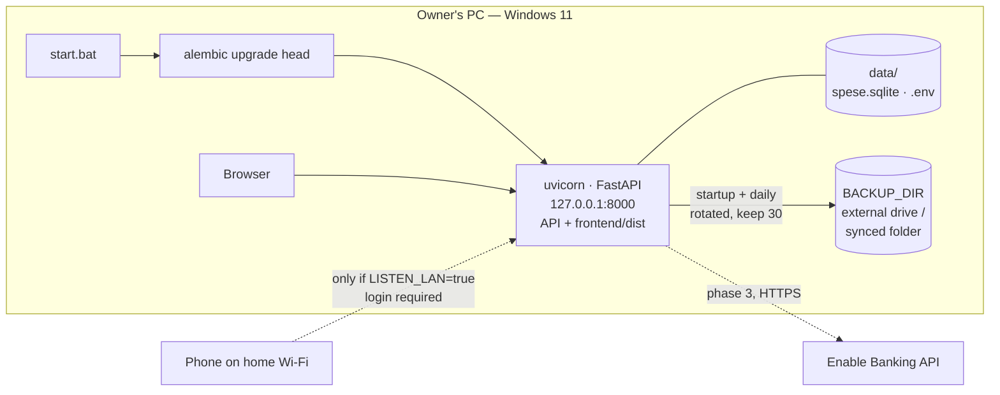

# Architecture

This is an overview of how ExTrack is built. The full design, with every
decision and its reasons, is in
[`design-dashboard-spese.md`](design-dashboard-spese.md) (Italian). That
document is the source of truth: if the two disagree, the design document wins.
The `§` references below point to its sections.

---

## 1. Principles

| Principle | What it means in practice |
|---|---|
| **Many sources → one database** (D6) | Each source is an independent adapter. Adding or removing a source never touches the dashboard or the data model. |
| **Adapters never write to the DB** | Adapters only produce `RawTransaction` objects. Everything goes through the ingestion pipeline. |
| **The dashboard reads only the DB** | No external source can break the dashboard. If a source stops working, existing data and manual entry still work. |
| **Every import is reversible** | Each import creates an `import_batch`, supports `dry_run`, and can be undone in one go. |
| **Integer cents, never floats** | `amount_cents: int`; negative = outflow, positive = inflow. |
| **Transfers are not expenses** (D11, D17) | Transfers between own accounts and Trade Republic investment operations have `is_transfer = true` and are excluded from spending stats. |
| **Privacy first** (D15) | Runs on the owner's PC, binds to `127.0.0.1`, keeps secrets in `data/.env`, keeps no real data in the repo. |
| **No lock-in** | Full export to Excel/CSV is always available. |

---

## 2. Component overview



---

## 3. Ingestion pipeline

Every source follows the same flow. A dry run goes through every step except
the final commit and returns the report shown in the import preview.



**Validation per source**

| Source | Blocking checks |
|---|---|
| Excel (§8.1) | Headers match `config.yaml`; per month and section, the imported sum equals the `SUM` total cached in the file. |
| Trade Republic PDF (§8.2.1) | For every row `previous balance ± amount = reported balance`; inflow/outflow sums equal the summary; last balance equals the closing balance. |
| Bank CSV (§8.2.2–8.2.3) | Profile columns present; formats parse. *(Profiles pending sample files, I5.)* |

**Excel/bank cutoff (D19).** Before `CUTOFF_DATE` the Excel history is the
source of truth, and from that date on the bank statements are. Items on the
wrong side of the cutoff appear in the preview as "excluded" and can be picked
one by one. Manual entry works for any date.

---

## 4. Data model



Constraints: `UNIQUE(source, external_id)` when `external_id` is not null;
indexes on `booking_date`, `category_id`, `dedup_hash`. Every schema change
goes through an Alembic migration (`backend/migrations/`).

---

## 5. Deduplication (§9)



Data from different sources is never merged automatically. Excel and bank data
are never matched at all, because the cutoff date keeps them apart.

---

## 6. Categorization (§10)

- Rules are evaluated by `priority`, and the first match sets category, kind,
  merchant and `is_transfer`.
- With no match, `category_id = null` and the transaction goes to the **"Da
  categorizzare"** queue.
- A manual category choice sets `category_locked = true`. The app then offers
  to create a rule from it in one click.
- Rules never overwrite locked transactions. Re-applying rules to history
  always shows a preview first.
- Trade Republic movements are classified by **movement type**, not by
  description (`config.yaml → bank_profiles`):

| Type | Classification |
|---|---|
| Transazione con carta | expense, category from merchant rules |
| Commercio (buy, sell, savings plan) | investment, `is_transfer = true` |
| Bonifico | inflow → income, outflow → expense; to or from the account holder → transfer |
| Interessi / Premio | income |
| Imposte | expense |
| unknown | "Da categorizzare" + warning, **never dropped** |

---

## 7. Deployment (D15, §6.2)



- **One process** serves both the API and the compiled SPA.
- **No always-on jobs.** Backup (and bank sync in phase 3) runs at startup if it
  is overdue, then periodically while the app stays open.
- **Portable.** Paths are configurable and use `pathlib`, file I/O is
  `utf-8`, and nothing is OS-specific, so the app can move to a home server or a
  VPS without a rewrite.

---

## 8. Code layout

```
backend/
  app/
    main.py          FastAPI app: /api routes + static frontend
    __main__.py      launcher used by start.bat (host/port from settings)
    config.py        Settings (data/.env) + config.yaml loader
    api/             routers: HTTP only, no business logic
    models/          SQLAlchemy models (Base with naming convention)
    ingestion/
      adapters/      one module per source → RawTransaction
      pipeline       normalize → dedup → categorize → save
    services/        stats, rules engine, export, backup
    jobs/            APScheduler jobs
  migrations/        Alembic
  tests/             pytest; fixtures generated by scripts, fake data only
frontend/            Svelte + Vite + ECharts SPA (Italian UI)
config.yaml          source layouts, column mappings, bank profiles
.env.example         template for data/.env
data/                DB, backups, .env (git-ignored)
docs/                design document + this file
```

Dependencies point one way: `api → services / ingestion → models`. Services and
ingestion can be tested without FastAPI.

---

## 9. API surface (§12)

| Area | Endpoints |
|---|---|
| Transactions | `GET/POST /api/transactions`, `PATCH/DELETE /api/transactions/{id}`, `GET /api/transactions/duplicates`, `POST …/duplicates/{id}/resolve` |
| Categories & rules | `/api/categories`, `/api/rules`, `POST /api/rules/apply?dry_run=true` |
| Import | `POST /api/import/excel?dry_run=`, `POST /api/import/bank-statement?account=&format=pdf\|csv&dry_run=`, `GET /api/import/batches`, `DELETE /api/import/batches/{id}` |
| Stats | `/api/stats/summary`, `/by-category`, `/trend`, `/kind-split` |
| Investments | `/api/investments/snapshots`, `/api/investments/performance` |
| Sync | `POST /api/sync/bank`, `GET /api/sync/status` (phase 3) |
| Export | `GET /api/export?format=xlsx\|csv` |

Spending stats always exclude `is_transfer = true` and, by default, income.

---

## 10. Security (§13)

- Binds to `127.0.0.1` by default. `LISTEN_LAN=true` binds to `0.0.0.0` and
  **requires** login: an argon2/bcrypt password hash, an `HttpOnly` session
  cookie, and rate limiting. Until login exists, the launcher refuses to start
  in LAN mode.
- The app is never exposed to the Internet. If it moves to a server, it goes
  behind a VPN with HTTPS.
- Secrets live only in `data/.env` or key files under `data/`. They never go in
  code, logs, the frontend or git.
- Logs contain no full IBANs and no transaction descriptions, except at debug
  level.
- Real Excel and PDF files are git-ignored. Test fixtures are generated by
  scripts with invented data.

---

## 11. Roadmap (§15)

| Phase | Scope | Status |
|---|---|---|
| 0 | Gather requirements, decisions D1–D19 | ✅ done |
| **1 — MVP** | DB, Excel import, manual entry, categories, basic dashboard, export, backup, launcher | 🚧 **current** |
| 2 | Trade Republic PDF, then TR CSV and Intesa CSV; rule engine; "Da categorizzare" queue; full dedup | planned |
| 3 | Open Banking sync via Enable Banking (Intesa) | planned |
| 4 | Investment snapshots with reminders | planned |
| 5 | Budgets, recurrence detection, missing-recurring alerts | planned |
| Out of scope | `pytr`, Google Pay API, Android notifications, GoCardless, cloud deployment | — |

Open items: I5 (sample TR CSV and Intesa exports), I6 (TR coverage on Enable
Banking), I7 (exact cutoff date).
